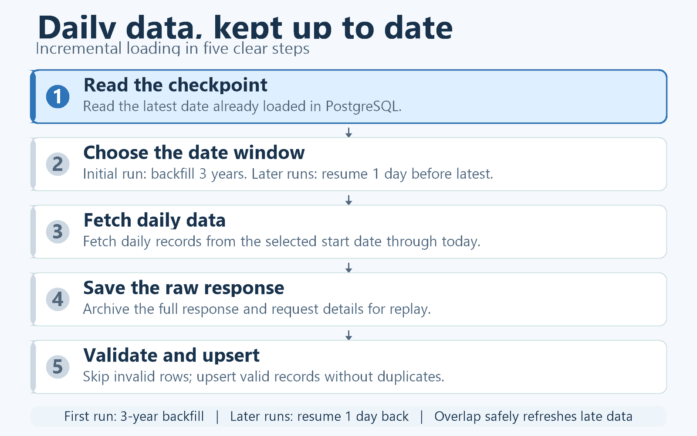

# Vuosaari Data Platform

Incremental ELT pipeline for daily electricity measurements from the Helsinki
Nuuka OpenAPI. Raw responses are archived in PostgreSQL; validated records are
upserted into an analytics-ready table.

## Pipeline behavior

1. Read the newest measurement timestamp from `energy_consumption`.
2. On an empty table, backfill the previous three years. Otherwise request from
   one day before the newest stored date through today.
3. Store the complete API response and request parameters in `energy_api_raw`.
4. Validate and normalize the daily measurements.
5. Upsert valid rows into `energy_consumption`.

The one-day overlap allows late or corrected daily data to be reloaded. The
table's unique key makes the overlap safe.

## Pipeline flow



## Project structure

```text
.
├── .env.example
├── .github/
│   └── workflows/
│       └── ci.yml
├── architecture.gif
├── pyproject.toml
├── uv.lock
├── src/
│   └── vuosaari_data_platform/
│       ├── config/
│       │   ├── api.py
│       │   └── database.py
│       ├── api_client.py
│       ├── clean_data_saving.py
│       ├── database.py
│       ├── pipeline.py
│       ├── raw_data_saving.py
│       ├── transformer.py
│       └── cli.py
├── sql_scripts/
│   └── table_creation.sql
├── tests/
└── README.md
```

## Requirements and installation

- Python 3.14
- `uv`
- PostgreSQL for pipeline execution

```bash
git clone <repository-url>
cd vuosaari_data_platform
uv sync --locked
```

## Configuration

Create `.env` from the template and set the API/database values for your
environment:

```powershell
Copy-Item .env.example .env
```

`.env` is ignored by Git. Keep credentials there or in the process environment;
never commit secrets. Set the API to the daily endpoint. Do not set `StartTime`
or `EndTime`: the initial run uses a three-year backfill, and later runs derive
the start date from the latest stored measurement. Environment variables take
precedence over values in `.env`.

## Database setup

Create a database matching `dbname` in `.env`, then create the tables:

```sql
CREATE DATABASE vuosaari;
```

```bash
psql -h localhost -U postgres -d vuosaari -f sql_scripts/table_creation.sql
```

The script creates:

- `energy_api_raw` for API payloads and request metadata
- `energy_consumption` for validated, deduplicated measurements

## Run the pipeline

```bash
uv run vuosaari-data-platform
```

Alternatively, run `uv run python -m vuosaari_data_platform`.

## Tests

The unit tests use mocks and do not require a live API or PostgreSQL:

```bash
uv run python -m unittest discover -s tests -v
```

GitHub Actions runs this suite on pushes and pull requests.
