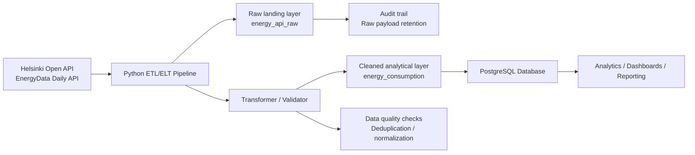

# Vuosaari Data Platform

A lightweight ELT pipeline for incrementally collecting daily electricity consumption data for Vuosaari and storing it in PostgreSQL. It preserves raw API responses, validates and normalizes records, and upserts cleaned measurements.

## Overview

This project automates ingestion from the Helsinki *Nuuka* OpenAPI daily service and stores both the original response and cleaned measurements in PostgreSQL. The first run backfills three years of data; later runs resume from the latest stored measurement, with a one-day overlap to account for delayed or corrected data.

The pipeline currently targets:

- Base endpoint: Helsinki OpenAPI Daily Energy Data
- Record type: `LocationName`
- Search value: `vuos`
- Reporting group: `Electricity`

## What the pipeline does

This project combines ELT and ETL principles:

1. Extracts daily energy data from the configured API endpoint.
2. Loads the complete raw JSON payload into PostgreSQL as the first storage stage, preserving the original source data.
3. Transforms the raw dataset by validating and cleaning each record.
4. Loads the cleaned values into the `energy_consumption` table for analytics and reporting.
5. Uses PostgreSQL unique constraints to avoid duplicate records for the same timestamp, reporting group, location name, and unit.

## Architecture diagram



This architecture keeps the original API payload for traceability and reprocessing, while the transformed data becomes the trusted layer for downstream analysis.

## Project structure

```text
.
├── .gitignore                 # Secrets and generated-file exclusions
├── .env.example               # Environment variable template
├── architecture.gif           # Animated incremental pipeline diagram
├── .python-version            # Python version used by uv
├── .github/
│   └── workflows/
│       └── ci.yml             # Automated test workflow
├── pyproject.toml             # Python project metadata and dependencies
├── uv.lock                    # Lock file generated by uv
├── src/
│   └── vuosaari_data_platform/
│       ├── __init__.py
│       ├── __main__.py        # Module entry point
│       ├── config/
│       │   ├── __init__.py    # Shared environment loading
│       │   ├── api.py         # API settings
│       │   └── database.py    # PostgreSQL settings
│       ├── api_client.py
│       ├── clean_data_saving.py
│       ├── database.py
│       ├── pipeline.py
│       ├── raw_data_saving.py
│       ├── transformer.py
│       └── cli.py
├── sql_scripts/
│   └── table_creation.sql     # PostgreSQL table definitions
├── tests/
│   ├── test_api_client.py
│   ├── test_config.py
│   ├── test_data_saving.py
│   ├── test_database.py
│   ├── test_pipeline.py
│   └── test_transformer.py
└── README.md
```

## Prerequisites

Before running the project, make sure you have:

- Python 3.14
- `uv` installed
- PostgreSQL running locally or in a reachable environment to run the pipeline
- A database matching the `dbname` value in `.env` to run the pipeline

## Installation

Clone the repository and install dependencies:

```bash
git clone <repository-url>
cd vuosaari_data_platform
uv sync --locked
```

## Configuration

Runtime configuration is loaded from the project-root `.env` file. Create it
from the template and set the values for your environment:

```powershell
Copy-Item .env.example .env
```

Edit `.env` before running the pipeline. It contains the daily API endpoint,
request filters, and PostgreSQL connection credentials, and is excluded from
Git. Do not set `StartTime` or `EndTime` there: for an empty table the pipeline
uses a three-year initial backfill through today; subsequent runs use the newest
stored measurement minus one day through today. The overlapping day is safe
because cleaned measurements are upserted by their unique key. Environment
variables take precedence over matching values in `.env`.

The automated unit tests do not require a live API or PostgreSQL database. Run
them with:

```bash
uv run python -m unittest discover -s tests -v
```

## Database setup

Create the required database and tables before running the pipeline:

Create database by running in *psql*
```bash
CREATE DATABASE vuosaari;
```

```bash
psql -h localhost -U postgres -d vuosaari -f sql_scripts/table_creation.sql
```

The SQL script creates:

- `energy_api_raw`: stores the original API response metadata and payload
- `energy_consumption`: stores cleaned, deduplicated energy records

## Running the pipeline

Start the ingestion pipeline:

```bash
uv run vuosaari-data-platform
```

Alternatively, run it as a module with `uv run python -m vuosaari_data_platform`.
The source is packaged using a `src/` layout and installed by `uv sync`.

This executes the incremental pipeline:

```text
Read latest timestamp -> Choose backfill/incremental window -> Fetch daily data
-> Store raw response -> Validate and normalize -> Upsert measurements
```

If the pipeline completes successfully, you will see log output describing the number of records fetched, cleaned, and saved.

## Data model

`energy_consumption` stores one row per unique combination of:

- `timestamp`
- `reporting_group`
- `location_name`
- `unit`

The table includes:

- `timestamp`: measurement time
- `reporting_group`: type of reporting group such as electricity
- `location_name`: location identifier/name
- `value`: numeric measurement value
- `unit`: unit of measurement

## Notes

- Raw API responses are retained in `energy_api_raw` for auditing and reprocessing.
- The `transformer.py` layer validates fields like `timestamp`, `reportingGroup`, `locationName`, and `unit` before insertion.
- Keep credentials in `.env` or the execution environment; never commit them.

## Future improvements

Potential next steps for the project include:

- scheduled ingestion
- exposing dashboards or analytics on top of the cleaned data
