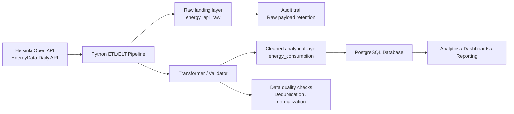

```

```

# Vuosaari Data Platform

A lightweight ELT and ETL pipeline for collecting daily electricity consumption data for Vuosaari and storing it in PostgreSQL. The project first loads the raw API response into the database, then transforms and cleans the data before making it available for analysis. This ELT-first design preserves the original payload while still applying ETL-style validation and normalization.

## Overview

This project is designed to automate the ingestion of energy data from the Helsinki *Nuuka* OpenAPI service and persist both the original response and the cleaned dataset in a relational database. It follows an ELT pattern by landing raw data first, then applying transformation logic in the pipeline, which gives it ETL characteristics as well. It is especially useful for monitoring building or area-level energy usage trends over time.

The pipeline currently targets:

- Base endpoint: Helsinki OpenAPI Daily Energy Data
- Record type: `LocationName`
- Search value: `vuos`
- Reporting group: `Electricity`

## What the pipeline does

This project combines ELT and ETL principles:

1. Extracts daily energy data from the configured API endpoint.
2. Loads the complete raw JSON payload into PostgreSQL as the first storage stage, preserving the original source data.
3. Transforms the raw dataset by validating and cleaning each record.
4. Loads the cleaned values into the `energy_consumption` table for analytics and reporting.
5. Uses PostgreSQL unique constraints to avoid duplicate records for the same timestamp, reporting group, location name, and unit.

## Architecture diagram



This architecture keeps the original API payload for traceability and reprocessing, while the transformed data becomes the trusted layer for downstream analysis.

## Project structure

```text
.
├── config.toml                # API and PostgreSQL configuration
├── main.py                    # Placeholder entry point
├── pyproject.toml             # Python project metadata and dependencies
├── uv.lock                    # Lock file generated by uv
├── pipeline/
│   ├── api_client.py          # API retrieval logic
│   ├── clean_data_saving.py   # Inserts cleaned rows into PostgreSQL
│   ├── config.py              # Loads config values from config.toml
│   ├── database.py            # PostgreSQL connection helper
│   ├── pipeline.py            # Main ETL orchestration
│   ├── raw_data_saving.py     # Stores raw JSON payloads
│   └── transformer.py         # Cleans and validates raw records
├── sql_scripts/
│   └── table_creation.sql     # PostgreSQL table definitions
├── tests/                     # Test folder
└── README.md
```

## Prerequisites

Before running the project, make sure you have:

- Python 3.14
- `uv` installed
- PostgreSQL running locally or in a reachable environment
- A database named `vuosaari` (or update the config to match your setup)

## Installation

Clone the repository and install dependencies:

```bash
git clone <repository-url>
cd vuosaari_data_platform
uv sync
```

## Configuration

The project reads runtime configuration from `config.toml`.

```toml
BASE_URL = 'https://helsinki-openapi.nuuka.cloud/api/v1.0/EnergyData/Daily/ListByProperty'
Record = 'LocationName'
SearchString = 'vuos'
ReportingGroup = 'Electricity'
StartTime = '2026-01-01'
EndTime = '2026-12-10'

[postgresql]
host = "localhost"
port = 5432
dbname = "vuosaari"
user = "postgres"
password = "your-password"
```

Update the values as needed for your environment before running the pipeline.

## Database setup

Create the required database and tables before running the ETL job:

Create database by running in *psql*

```psql
CREATE DATABASE vuosaari;
```

```bash
psql -h localhost -U postgres -d vuosaari -f sql_scripts/table_creation.sql
```

The SQL script creates:

- `energy_api_raw`: stores the original API response metadata and payload
- `energy_consumption`: stores cleaned, deduplicated energy records

## Running the pipeline

Start the ingestion pipeline:

```bash
uv run pipeline/pipeline.py
```

This executes the full ELT/ETL flow:

```text
Extract API data -> Load raw response -> Transform and clean records -> Load structured data
```

If the pipeline completes successfully, you will see log output describing the number of records fetched, cleaned, and saved.

## Data model

`energy_consumption` stores one row per unique combination of:

- `timestamp`
- `reporting_group`
- `location_name`
- `unit`

The table includes:

- `timestamp`: measurement time
- `reporting_group`: type of reporting group such as electricity
- `location_name`: location identifier/name
- `value`: numeric measurement value
- `unit`: unit of measurement

## Notes

- Raw API responses are retained in `energy_api_raw` for auditing and reprocessing.
- The `transformer.py` layer validates fields like `timestamp`, `reportingGroup`, `locationName`, and `unit` before insertion.
- The configuration is intentionally simple and is appropriate for a local data-pipeline prototype or internal analytics workflow.

## Future improvements

Potential next steps for the project include:

- scheduling with cron or an orchestration tool
- adding tests for validation and database writes
- exposing dashboards or analytics on top of the cleaned data
- separating environment-specific configuration from the repository
